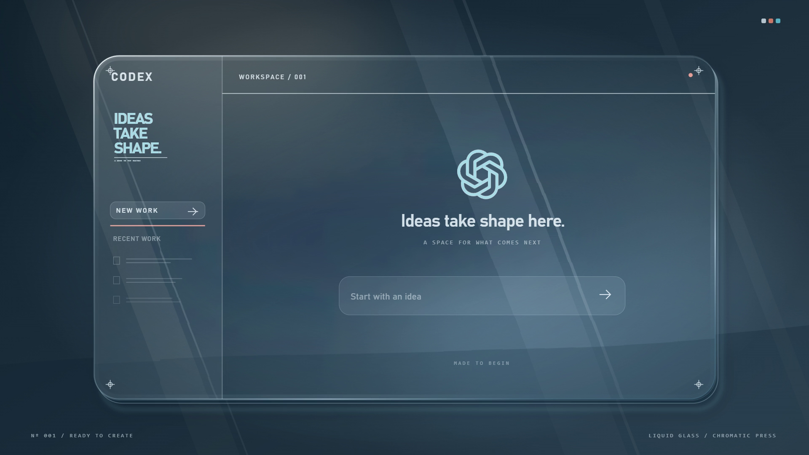
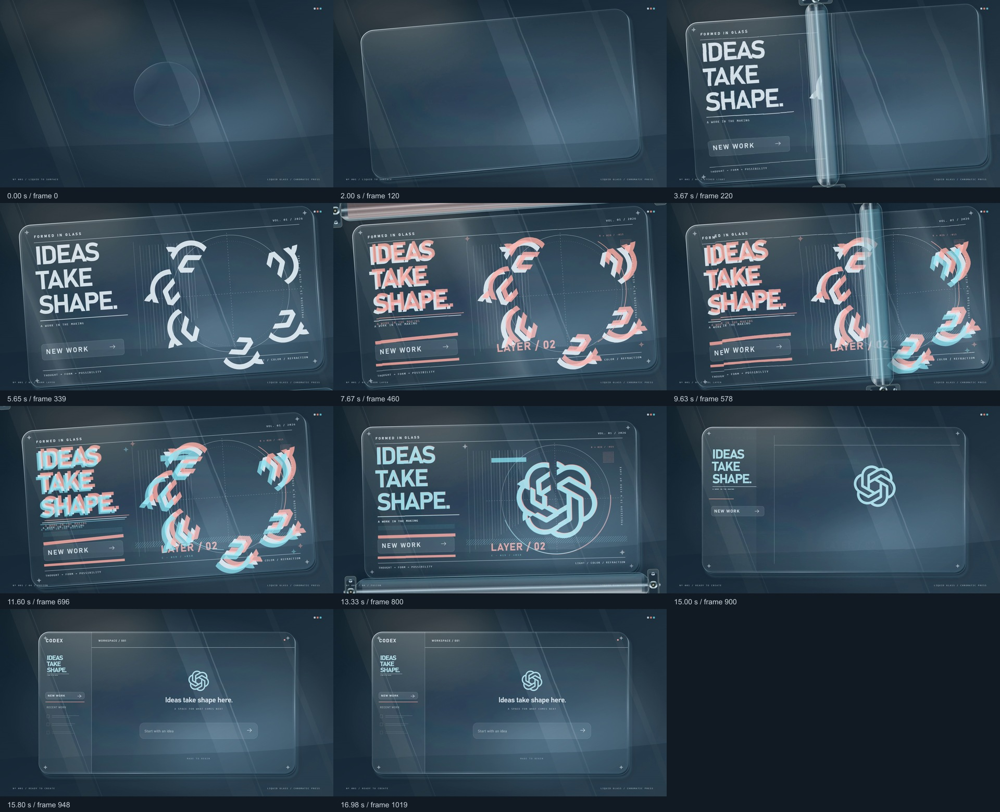

# Frosted Glass Startup

Frosted Glass Startup is a silent cinematic opening for Codex on Windows. A 17-second liquid glass printing sequence turns an idea into a workspace, then holds its final image until the Codex window is ready to use.



[Watch the 17-second film](https://github.com/yhc904444-eng/frosted-glass-startup/releases/download/v1.2.0/Codex-Liquid-Glass-Startup-1.2.0-Preview.mp4)

A clear droplet spreads into a sheet of glass. Transparent rollers print warm and cool layers across its refracting surface; the colors register, the original vector mark settles into place, and the artwork becomes a glass workspace. The printing is accelerated while the final assembly keeps room to breathe.



This is an independent community companion, unaffiliated with OpenAI. It works with the official Microsoft Store Codex app and the optional [Frosted Glass desktop customization](https://github.com/yhc904444-eng/frosted-glass). It does not include Codex or an OpenAI account.

## Install

1. Install OpenAI Codex for Windows, or the Frosted Glass desktop customization linked above.
2. Download **Codex-Liquid-Glass-Startup-1.2.0-Windows-x64-Setup.exe** from [Releases](https://github.com/yhc904444-eng/frosted-glass-startup/releases/latest).
3. Double-click the installer and select **Install**. No terminal, Node.js, Python, developer SDK, or manual configuration is needed.
4. Open Codex normally. The helper displays the opening once for each new client session. You can also use **Codex Liquid Glass Startup** from the Start menu, or **Preview animation** to watch without launching Codex.

Supports **Windows 10 22H2 and Windows 11, x64**. The supported Windows versions include .NET Framework 4.8. Setup checks for Microsoft WebView2 154 or newer and automatically runs Microsoft's bundled, signed Evergreen bootstrapper if it is missing or older. That step requires Internet access. The animation itself works offline.

The installer is not code-signed, so Windows may show an unknown-publisher warning. Compare its SHA-256 with `SHA256SUMS.txt` on the release page before running it.

## What it does

- Completely silent: the MP4 contains zero audio streams, and the video player is muted.
- Plays the film once, then shows a still of the final frame without looping.
- Displays the complete 1920 × 1080, 60 fps composition without cropping. Other window ratios use a matching softened background around the film.
- Enters only after film completion and two stable observations of an interactive Codex screen. Sign-in and onboarding actions count as usable screens too.
- Follows the Codex window without modifying its executable or account settings.
- Resolves all installation and profile paths on your PC. No developer-specific drive or username is required.

**Press Esc at any time** to dismiss the film. If accessibility information is unavailable, the final frame shows a clear reminder after 30 seconds; Esc remains available. The readiness check confirms local window controls, not model/network availability or successful authentication.

## Installation and removal

Setup installs for your Windows account at `%LOCALAPPDATA%\Programs\CodexLiquidGlassStartup`, creates Start menu shortcuts, and registers an uninstaller in **Windows Settings → Apps**. The default **Play when Codex opens** option starts a lightweight watcher with Windows; clear it if you only want the Start menu launcher. Run Setup again to change that option or update the app. No administrator rights are requested by this installer; a managed PC can impose its own runtime installation policy.

The helper's own WebView2 cache and diagnostic log are stored at `%LOCALAPPDATA%\CodexLiquidGlassStartup`. Uninstall removes only files listed by its installation record. It leaves Codex, OpenAI account data, and the shared Microsoft WebView2 runtime in place.

Client preference is automatic: public `CodexLiquidGlass`, legacy `CodexGlass`, then official Microsoft Store Codex. The two Glass clients use separate local profiles, matching their own installers. On a PC without Codex, **Preview animation** works; install Codex before using the workspace launcher.

## Build from source

The release installer includes everything needed by end users. Developers can build on 64-bit Windows using Windows PowerShell and the C# compiler included with .NET Framework:

```powershell
powershell -NoProfile -ExecutionPolicy Bypass -File .\Get-Media.ps1
powershell -NoProfile -ExecutionPolicy Bypass -File .\Build.ps1
```

`Build.ps1` downloads a pinned WebView2 SDK from NuGet, verifies its SHA-256, downloads Microsoft's signed runtime bootstrapper, builds the native launcher and installer, runs the policy tests, and writes the installer plus SHA-256 to `dist/`. The release payload is an explicit file list; profiles, logs, local QA, account data, and previous installations are excluded.

Media is stored as release assets rather than large Git objects. `Get-Media.ps1` downloads the v1.2.0 media ZIP and verifies its pinned SHA-256 before extraction. See [assets/README.md](assets/README.md) and [media-source/README.md](media-source/README.md) to reproduce the film instead.

See [validation](docs/VALIDATION.md), [architecture](docs/ARCHITECTURE.md), and [third-party notices](THIRD-PARTY-NOTICES.md).

## License

Original code and animation assets: MIT. Microsoft WebView2 is redistributed under its included Microsoft license. OpenAI's software, services, names, and trademarks are not relicensed by this project. Remotion has its own licensing terms for developers who render the film.
